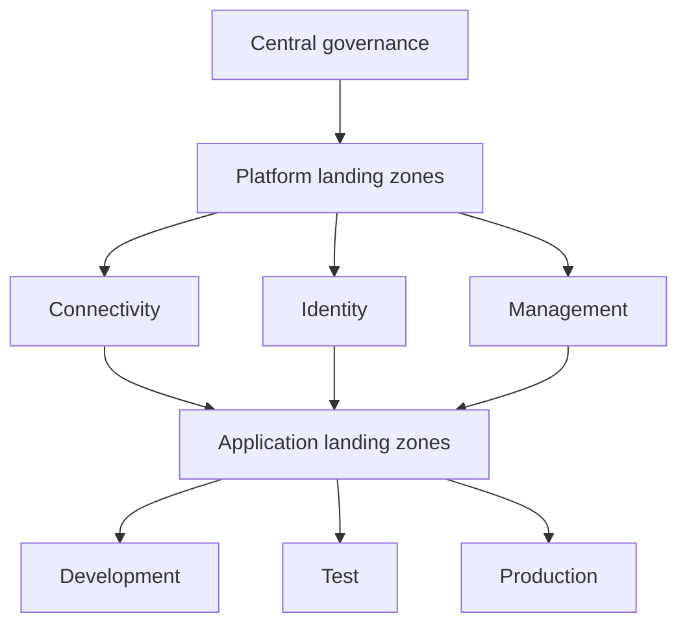

# Platform Overview

## Scope

The DfE Azure platform is a hybrid service spanning Azure, the corporate network and identity services. It includes:

- Microsoft Entra ID and Active Directory integration
- multiple Azure resource-hosting tenants
- management groups, subscriptions and resource groups
- Enterprise Landing Zone platform and application landing zones
- Azure Virtual WAN hubs
- Prisma Access and GlobalProtect
- Palo Alto Cloud NGFW
- DNS, PKI, Key Vault and private endpoints
- Azure Monitor and Microsoft Defender capabilities
- GitHub Enterprise, Azure DevOps and Infrastructure as Code
- backup, disaster recovery and cyber recovery.

## Operating model

Central teams provide common controls and shared platform components. Business-service teams own workload design, deployment and support within the guardrails.

## Architectural generations

| Generation | Characteristics | Status |
|---|---|---|
| Tier 1 | Shared subscriptions/VNets, central operations, legacy firewall and ExpressRoute patterns | Legacy |
| Separate tenant landing zones | Service subscriptions and improved autonomy, but guest identity and cross-tenant complexity | Current/transition |
| DfE ELZ | Dev/Test/Prod subscriptions, central hubs and policy, service autonomy in the primary tenant | Strategic target |
