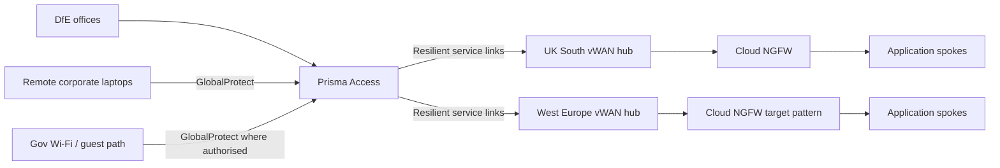

# Network Architecture

## Current high-level model



Offices do not use direct ExpressRoute as the primary model. The former BT MPLS and ExpressRoute design created a shared bottleneck and required numerous separately managed firewalls and gateways. Prisma Access now provides a common connectivity point for offices, remote users and Azure.

## Traffic-control layers

- **Prisma Access:** Central remote/office access and web security.
- **Azure vWAN:** Hub connectivity and route propagation.
- **Cloud NGFW:** Segmentation, internet control and east-west inspection.
- **WAF:** Layer 7 protection for inbound web applications.
- **Application controls:** NSGs, private endpoints, workload firewalls and identity controls.

## Architecture diagrams

Place approved exports from `Azure Landing Zone Wiki Diagrams-v0.4.vsdx` in `images/` and embed them here:

```markdown


```
