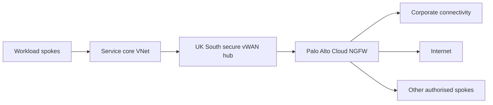

# UK South Architecture

**Status: Strategic target for new services.**

## Pattern

New services are generally onboarded into UK South with separate development, test and production subscriptions. Each service receives a core VNet connected to the secure vWAN hub.

Cloud NGFW scales according to traffic and centrally controls traffic between spokes, corporate networks and the internet.

## Expected service pattern

- Dev/Test/Prod subscription separation
- custom environment-specific corporate DNS
- Entra ID group-based RBAC
- PIM for elevated access
- inherited policy guardrails
- private endpoints where required
- Infrastructure as Code
- service-owned monitoring and recovery.
