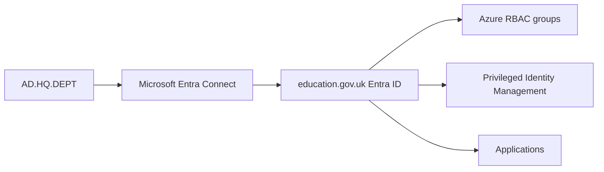

# Identity and Access

## Corporate identity chain

Identity is a Tier 0 dependency. Standard user identities originate in corporate Active Directory and are synchronised into Entra ID.

## Subscription access groups

Subscriptions should use Entra ID groups for:

- Readers
- Contributors
- management/service owners
- authorised PIM approvers.

## Environment model

| Environment | Typical elevation model |
|---|---|
| Development | Contributor may be permanently assigned where approved |
| Test | Time-limited PIM activation, commonly self-approved |
| Production | Time-limited PIM activation requiring authorised approval |

## Controls

- separate admin and standard identities where policy requires
- least privilege
- no unmanaged standing production Contributor/Owner access
- managed identities for workloads where possible
- emergency access accounts that are monitored and tested
- access reviews for privileged groups and guest identities.
