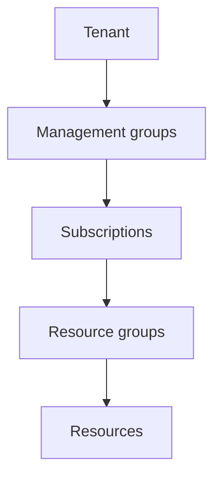

# Governance and Azure Policy

## Resource hierarchy

Policy and RBAC should be assigned as high in the hierarchy as practical and inherited downward.

## Typical policy guardrails

- allowed Azure regions
- permitted VM SKUs
- required tags
- encryption requirements
- diagnostic settings
- private-endpoint requirements
- restrictions on public network access
- regulatory/security initiatives.

## Minimum tags

| Tag | Example |
|---|---|
| `ServiceName` | Funding Service |
| `Environment` | Dev / Test / Prod |
| `ServiceOwner` | Team or role mailbox |
| `CostCentre` | Approved finance code |
| `Criticality` | Tier 0-3 |
| `DataClassification` | Official / Official-Sensitive |
| `ManagedBy` | Terraform / Bicep / Portal |

Tag names and allowed values must be aligned with the current DfE policy definitions before enforcement.
