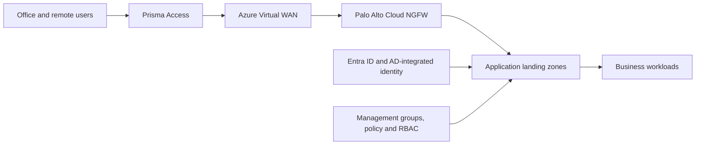

# DfE Azure Platform

> **Purpose:** A practical technical reference for understanding, governing, operating and evolving the DfE Azure platform.

## Platform at a glance

DfE operates a hybrid, multi-tenant Azure estate. The strategic direction is the **Enterprise Landing Zone (ELZ)** in the primary DfE tenant, with centrally governed platform services and service-owned application landing zones.

## Start here

- [Platform overview](01-Platform-Overview)
- [Enterprise Landing Zone](02-Enterprise-Landing-Zone)
- [Tenants and environments](03-Tenants-and-Environments)
- [Network architecture](04-Network-Architecture)
- [Identity and privileged access](09-Identity-and-Access)
- [Governance and Azure Policy](12-Governance-and-Azure-Policy)
- [Operations and ownership](15-Operations-and-Ownership)
- [Migration and roadmap](17-Migration-and-Roadmap)

## Architectural principles

1. **Central guardrails, service autonomy.** Platform teams provide shared connectivity, identity integration, DNS, policy and security controls. Service teams design, deploy and support workloads within those controls.
2. **UK South is the default target pattern.** New services generally use separate development, test and production subscriptions connected to a secure vWAN hub.
3. **Legacy is not the target state.** Tier 1 and legacy West Europe patterns must be clearly labelled to avoid reuse by new services.
4. **Identity and DNS are platform dependencies.** They must be designed and recovered as Tier 0 services.
5. **Availability is not recovery.** High availability, disaster recovery and cyber recovery require separate evidence and tests.
6. **Infrastructure should be reproducible.** Infrastructure as Code and reviewed pipelines are preferred to portal-built resources.

## Documentation status labels

- **Current:** Observed operating model.
- **Target:** Intended strategic architecture.
- **Legacy:** Retained for existing workloads only.
- **Transition:** Migration or standardisation in progress.
- **Validate:** Requires current owner confirmation.
